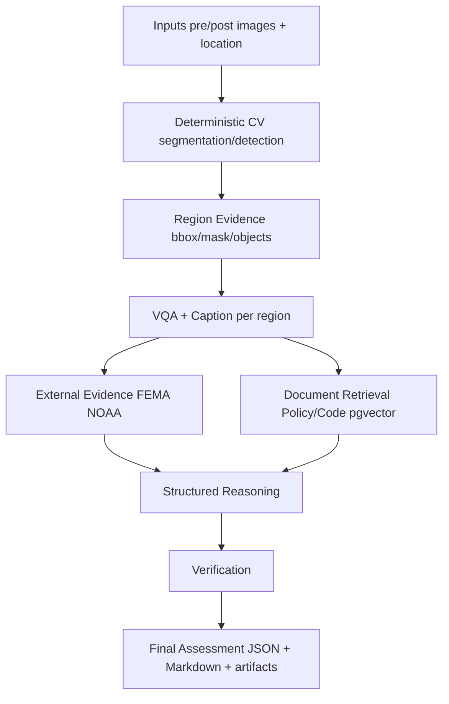

# TerraTriage — Production-Shaped Multimodal Disaster Damage Assessment

TerraTriage is a *small but serious* ML platform that demonstrates how heterogeneous inference, agents, RAG, evaluation, and production serving fit together — not a chatbot wrapper around one multimodal LLM.

## 1. Problem

Given a pre/post image pair (optionally with `lat, lon` and timestamps), produce a **severity assessment** (`NO_DAMAGE → DESTROYED`) that is **evidence-grounded**, **retrieval-aware**, and **verifiable**, with explicit uncertainties and a human-review gate. The pipeline must survive missing inputs, model failures, and offline external APIs without fabricating results.

## 2. Architecture



Rules enforced in code:
- `raw input → model observation → structured evidence → contextual evidence → reasoning → verification → final assessment` (`terratriage/agents/nodes.py:reason_severity_node`).
- Every claim in `DamageAssessment.rationale` cites `evidence_refs` (`terratriage/schemas:Evidence`); verification is deterministic where possible (`terratriage/agents/verifier.py`).
- All agent boundaries use Pydantic v2 (`terratriage/schemas`, `terratriage/agents/state.py:GraphState`).

See `docs/architecture.md`, `docs/data-contracts.md`, and `docs/decisions/` (ADRs 001–005).

## 3. Demo

No credentials, GPUs, or Postgres required:

```bash
pip install -e ".[dev]"
terratriage assess --demo
# → artifacts/assessments/<id>/report.json + report.md

terratriage evaluate --dataset data/eval/sample
# → evaluation_results/run_<TS>/{metrics.json,case_results.jsonl,failures.jsonl,summary.md}
```

`terratriage assess --demo` exercises the real graph and evidence contract via deterministic mocks clearly labeled `mock::demo` / `demo_mode` — it is not a separate fake workflow.

## 4. Why This Architecture

- **Multi-agent over one LLM** — isolates perception, grounding, and verification; hallucination becomes measurable (`docs/evaluation.md`).
- **LangGraph** — typed `StateGraph[GraphState]` with conditional edges (skip NOAA with no coords, downgrade on missing evidence).
- **Heterogeneous models behind interfaces** — `SegmentationModel`/`DetectionModel`/`VQAModel`/`EmbeddingModel`/`LLM` are swappable via `terratriage/config` (env: `TERRATRIAGE_MODEL_*`).
- **Region evidence** — localizes damage; targets VQA per region and bounds cost.
- **RAG separate from reasoning** — LlamaIndex + Postgres/pgvector expose `precision@k`/`recall@k`/`mrr` independently; reasoning consumes scored chunks as `PolicyContext`.

`docs/interview-guide.md` explains each decision in repo-grounded detail.

## 5. Setup

```bash
git clone <repo> && cd TerraTriage
cp .env.example .env   # edit model IDs / provider keys as needed
pip install -e ".[dev]"

# Optional: bring up pgvector + redis + api
docker compose up --build
```

Python 3.12+. Heavy vision models download on first `ModelFactory` use; set `TERRATRIAGE_MODEL_DEVICE=cpu` for CPU-only.

## 6. Local Execution

```bash
# CLI
terratriage assess --pre data/eval/sample/case_000/pre.jpg --post data/eval/sample/case_000/post.jpg --location 29.76,-95.36
terratriage assess --demo
terratriage evaluate --dataset data/eval/sample
terratriage ingest data/raw
terratriage benchmark --n 20 --concurrency 2
terratriage serve --port 8000

# API (same semantics, async jobs)
curl http://localhost:8000/health
curl -X POST http://localhost:8000/assessments -H 'Content-Type: application/json' \
  -d '{"pre_image_uri":"data:image/jpeg;base64,...","post_image_uri":"data:image/jpeg;base64,...","demo":true}'
curl http://localhost:8000/assessments/<assessment_id>
```

API responses always contain `assessment`, `confidence`, `damage_categories`, `evidence`, `external_validation`, `retrieval_context`, `uncertainties`, `human_review_required`, and `trace_id` — never raw LLM text.

## 7. Dataset Preparation

```bash
# Synthetic fixture (ships in repo)
ls data/eval/sample/manifest.json

# xBD (user-downloaded; never auto-downloaded)
python scripts/prepare_xbd.py --xbd-root /data/xBD --output data/eval/xbd
# Expected layout documented in terratriage/evaluation/xbd_adapter.py:XBDAdapter
```

## 8. Model Configuration

All identifiers are env-driven (`terratriage/config:ModelConfig`):

```
TERRATRIAGE_MODEL_SEGMENTATION_MODEL_ID=nvidia/segformer-b0-finetuned-ade-512-512
TERRATRIAGE_MODEL_DETECTION_MODEL_ID=facebook/detr-resnet-50
TERRATRIAGE_MODEL_VQA_MODEL_ID=dandelin/vilt-b32-finetuned-vqa
TERRATRIAGE_MODEL_CAPTIONING_MODEL_ID=Salesforce/blip-image-captioning-base
TERRATRIAGE_MODEL_EMBEDDING_MODEL_ID=sentence-transformers/all-MiniLM-L6-v2
TERRATRIAGE_MODEL_LLM_MODEL_ID=microsoft/Phi-3-mini-4k-instruct
TERRATRIAGE_MODEL_DEVICE=cpu
```

`ModelFactory` memoizes singletons; `ModelFactory.reset()` clears them in tests.

## 9. Evaluation

```bash
python -m terratriage.evaluation.run --dataset data/eval/sample --config configs/eval.yaml
# or
terratriage evaluate --dataset data/eval/sample --max-cases 10
```

Metrics: `segmentation_iou`/`dice`, `detection_map`, `classification_accuracy`/`macro-f1`, `vqa_accuracy`, `retrieval precision`/`recall`/`mrr`, `citation_accuracy`, `hallucination_rate`/`unsupported_claim_rate`/`contradiction_rate`/`evidence_coverage`, `severity_accuracy`/`macro-f1`, `latency p50`/`p95`. Unavailable metrics are `"NOT_AVAILABLE"`, never invented (`docs/evaluation.md`).

## 10. Observability

Every `GraphState` node emits a span (`terratriage/utils/tracing.py`):

```
assessment_id, trace_id, node_name, model, model_version,
start_time, duration_ms, status, error, input_hashes, output_schema
```

Default is `InMemoryTracer` (tests); set `TERRATRIAGE_OBS_PROVIDER=langfuse` to forward to Langfuse. Model calls emit `latency_ms`/`estimated_cost`/`input_size`/`output_size` (`docs/observability.md`).

## 11. Deployment

- `Dockerfile` (`python:3.12-slim`, `pip install -e .`, no weights baked in)
- `docker-compose.yml` (api + worker + `ankane/pgvector` + `redis:7-alpine`)
- Provider adapters are interfaces; `local` ships first, `Modal`/`Baseten`/`Replicate` are clean adapters (see `docs/deployment.md` and `docs/model-selection.md`).

GPU is externally configurable (`TERRATRIAGE_MODEL_DEVICE=cuda`, `TORCH_DTYPE=float16`).

## 12. Limitations

- Segmentation/detection are ImageNet/ADE-pretrained, not fine-tuned on xBD — masks are coarse placeholders.
- VQA is a compact ViLT model; larger VLMs will improve template accuracy at higher cost.
- Policy corpus is three demo docs (`data/raw/*.txt`) clearly labeled `DEMONSTRATION DOCUMENT — NOT OFFICIAL ...` — official FEMA/building-code text is not represented.
- pgvector corpus is tiny; evaluation uses synthetic imagery (real benchmark requires `scripts/prepare_xbd.py`).

## 13. Known Failure Modes

- Low-confidence vision → `UNKNOWN` severity, `human_review_required=True`, review reason `missing_visual_evidence` or `confidence_below_threshold`.
- FEMA/NOAA unreachable → `PipelineError(recoverable=True)`, fixture fallback when `USE_FIXTURES=true`, uncertainty noted, review flagged on mismatch.
- No relevant policy chunks → `uncertainties=["No policy context retrieved"]`, `retrieval_ambiguity` review flag.
- Contradiction (e.g., `DESTROYED` with weak evidence) → `VerificationResult.contradictions_found`, `passed=False`.

## 14. Future Work

- Fine-tune vision on xBD train; wire real `segmentation_iou`/`detection_map` and publish them honestly.
- Structured LLM reasoning with schema-validated JSON + RAGAS faithfulness metrics.
- Postgres migrations, Redis/RQ job queue, auth, `prometheus-client` histograms, and K8s manifests.
- Expand demo corpus and add golden retrieval relevance labels.

## 15. Source Discipline

- `data/raw/*.txt` — **demonstration source** (synthetic, labeled as such)
- `data/eval/sample/` — **synthetic evaluation source**
- FEMA (`fema.gov/api/open/v2`) and NOAA (`api.weather.gov`) — **official sources** (via typed adapters `terratriage/integrations/fema.py`, `noaa.py`, with timeout/retry/rate-limiting/validation; fixture mode is explicit when credentials are absent)

Official, demo, and synthetic sources are never conflated in docs or API responses.
